# InzaiQ POS Starter

**Una base preparada para agentes, ventas, inventario y comercios multitenant.**

Creá un punto de venta con marca propia en Next.js y permití que sus administradores lo operen desde la interfaz o desde un agente MCP autorizado. Los servicios modulares, contratos explícitos y reglas de negocio compartidas facilitan extender cada instalación.

[English](README.md) · [Español](README.es.md)

[](https://github.com/JuanCG13/inzaiq-pos-starter/actions/workflows/ci.yml)
[](LICENSE)
[](package.json)
[](package.json)

[Inicio rápido](#inicio-rápido) · [Funciones](#qué-incluye) · [MCP](#conectar-un-agente) · [Documentación](docs/README.md) · [Últimos cambios](CHANGELOG.es.md)

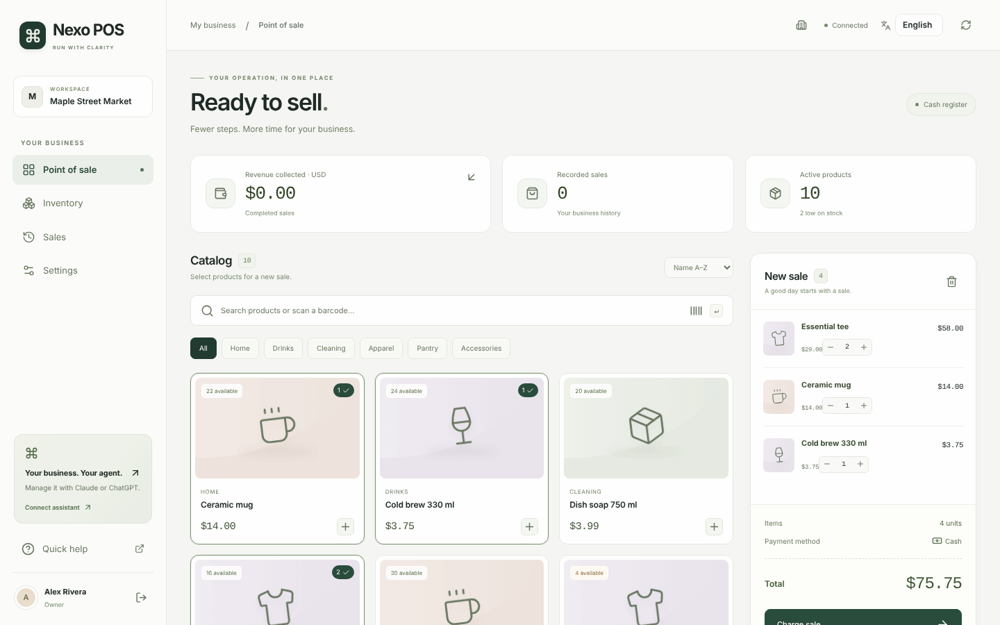

*Las capturas muestran la interfaz de referencia personalizable **Nexo POS** en inglés y con la moneda predeterminada USD. La interfaz también se entrega en español y admite más idiomas mediante diccionarios tipados; cada instalación adapta su marca, moneda, formato regional y textos. [Todas las pantallas →](docs/screenshots/README.md)*

## Qué incluye

| Capacidad | Implementación |
| --- | --- |
| **Caja en efectivo** | Búsqueda de productos, entrada por SKU o lector de códigos con teclado, carrito con control de stock, efectivo recibido, cambio y ticket imprimible |
| **Catálogo e inventario** | Alta y edición de productos, categorías, control de versión y ajustes de stock auditados |
| **Ventas y reportes** | Historial persistente y métricas de la base de datos, separadas por moneda |
| **Idiomas y moneda** | Inglés y español incluidos y seleccionables por persona; se añade un idioma con un diccionario tipado. USD por defecto, configurable por instalación y por producto |
| **Múltiples empresas** | Organizaciones de Better Auth con membresía verificada y roles owner, admin, cashier y viewer |
| **Administración por agentes** | SDK oficial MCP, Streamable HTTP, OAuth/PKCE, herramientas con scopes y consentimiento revocable |
| **Ajustes operativos en vivo** | Avisos por empresa y pausa/reanudación de nuevas ventas, con control de versión y auditoría |
| **Diagnóstico** | Logs estructurados, correlación por solicitud, auditoría transaccional y exportación OpenTelemetry opcional |

**Stack:** Next.js App Router · React · TypeScript · Better Auth · Kysely · Radix · Lucide. Los adaptadores admiten **Supabase, Neon, PostgreSQL y Turso**, con SQLite local para desarrollo.

La interfaz, las rutas HTTP y las herramientas MCP usan el mismo servicio de dominio. El acceso a cada empresa surge de membresía verificada; los importes usan unidades menores enteras y precios del servidor. Ventas, stock y auditoría se confirman juntos, con idempotencia persistente para evitar operaciones duplicadas. Los agentes reciben herramientas de negocio concretas, nunca acceso SQL arbitrario.

### Más pantallas

| Inventario | Historial de ventas |
| --- | --- |
| 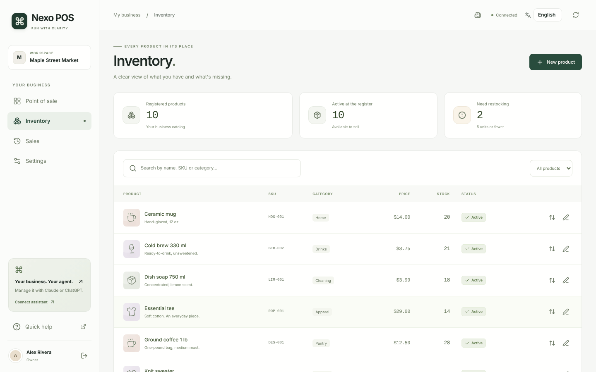 | 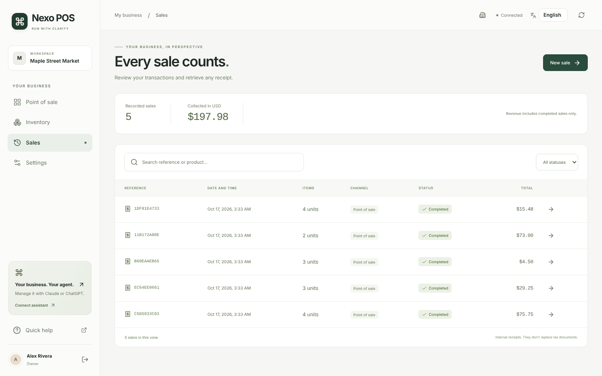 |

<details>
<summary>Punto de venta móvil</summary>

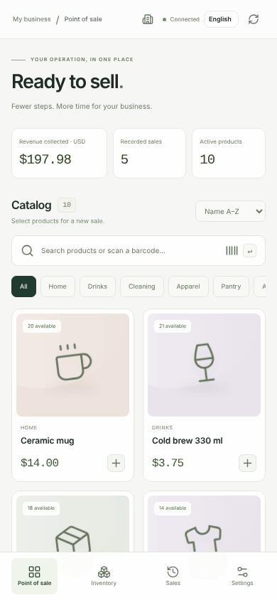

</details>

### Todas las pantallas

Las miniaturas enlazan a la imagen completa. Las capturas están en inglés (la interfaz de referencia se ve en el idioma del navegador, también en español) y se regeneran con `npm run docs:screenshots` ([cómo se capturan](docs/screenshots/README.md)).

<!-- screens:start -->
<table>
<tr><td width="25%" align="center" valign="top"><a href="docs/screenshots/en/01-sign-in.png">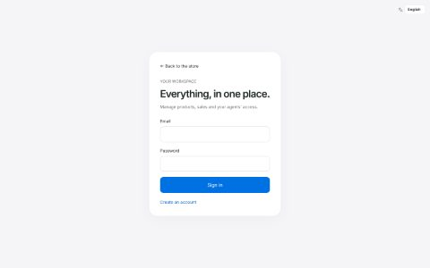</a><br><sub>Sign in</sub></td><td width="25%" align="center" valign="top"><a href="docs/screenshots/en/02-create-account.png">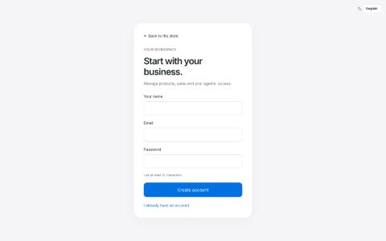</a><br><sub>Create account</sub></td><td width="25%" align="center" valign="top"><a href="docs/screenshots/en/03-onboarding.png">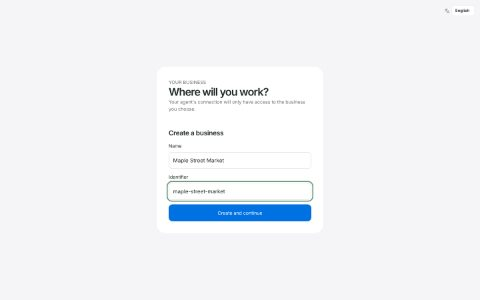</a><br><sub>Create or choose a business</sub></td><td width="25%" align="center" valign="top"><a href="docs/screenshots/en/04-pos-empty.png">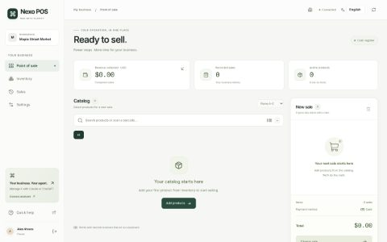</a><br><sub>Empty catalog</sub></td></tr>
<tr><td width="25%" align="center" valign="top"><a href="docs/screenshots/en/05-pos-catalog.png">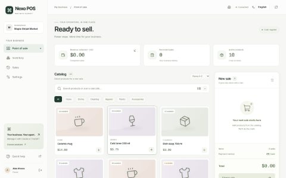</a><br><sub>Point of sale</sub></td><td width="25%" align="center" valign="top"><a href="docs/screenshots/en/06-pos-cart.png">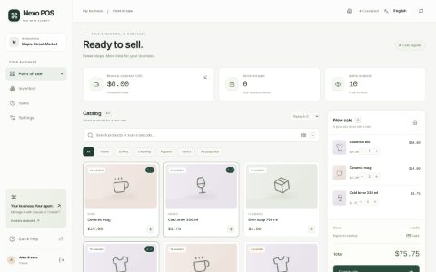</a><br><sub>Cart</sub></td><td width="25%" align="center" valign="top"><a href="docs/screenshots/en/07-pos-checkout.png">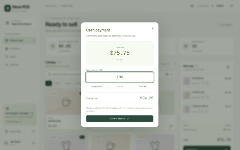</a><br><sub>Cash checkout</sub></td><td width="25%" align="center" valign="top"><a href="docs/screenshots/en/08-pos-receipt.png">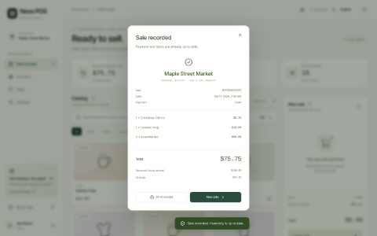</a><br><sub>Receipt</sub></td></tr>
<tr><td width="25%" align="center" valign="top"><a href="docs/screenshots/en/09-inventory.png">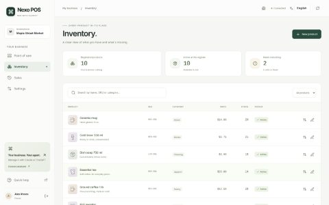</a><br><sub>Inventory</sub></td><td width="25%" align="center" valign="top"><a href="docs/screenshots/en/10-inventory-new-product.png">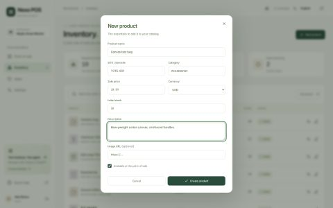</a><br><sub>New product</sub></td><td width="25%" align="center" valign="top"><a href="docs/screenshots/en/11-inventory-adjust-stock.png">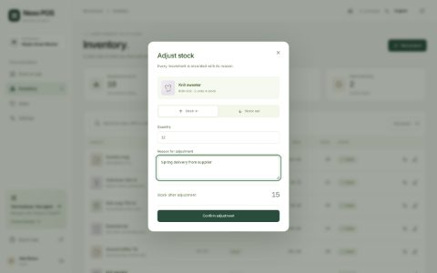</a><br><sub>Adjust stock</sub></td><td width="25%" align="center" valign="top"><a href="docs/screenshots/en/12-sales.png">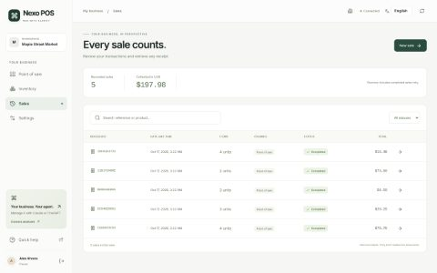</a><br><sub>Sales</sub></td></tr>
<tr><td width="25%" align="center" valign="top"><a href="docs/screenshots/en/13-sale-details.png">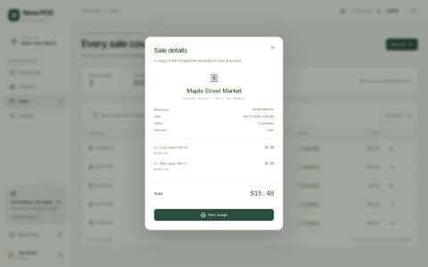</a><br><sub>Sale details</sub></td><td width="25%" align="center" valign="top"><a href="docs/screenshots/en/14-settings.png">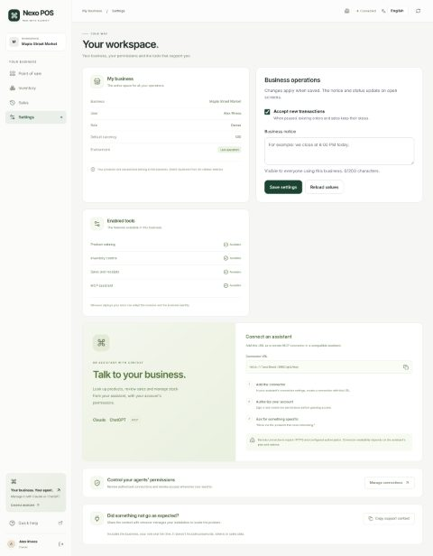</a><br><sub>Settings</sub></td><td width="25%" align="center" valign="top"><a href="docs/screenshots/en/15-quick-help.png">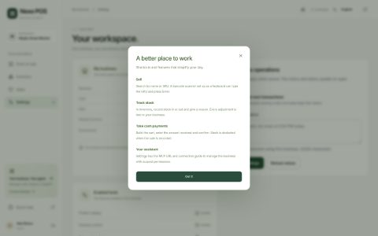</a><br><sub>Quick help</sub></td><td width="25%" align="center" valign="top"><a href="docs/screenshots/en/16-pos-paused.png">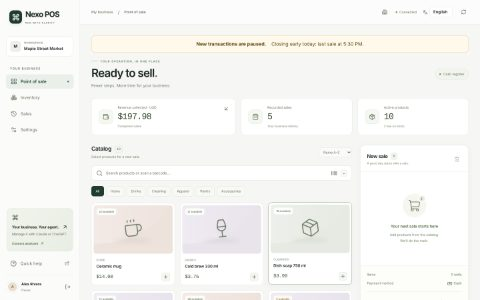</a><br><sub>Paused register with notice</sub></td></tr>
<tr><td width="25%" align="center" valign="top"><a href="docs/screenshots/en/17-oauth-consent.png">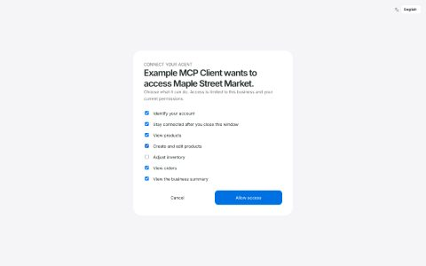</a><br><sub>Agent consent</sub></td><td width="25%" align="center" valign="top"><a href="docs/screenshots/en/18-connected-agents.png">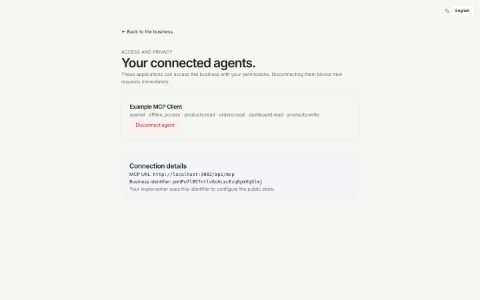</a><br><sub>Connected agents</sub></td><td width="25%" align="center" valign="top"><a href="docs/screenshots/en/19-not-found.png">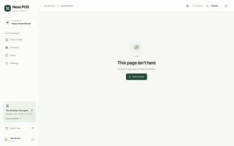</a><br><sub>Not found</sub></td><td width="25%" align="center" valign="top"><a href="docs/screenshots/en/20-mobile-pos.png">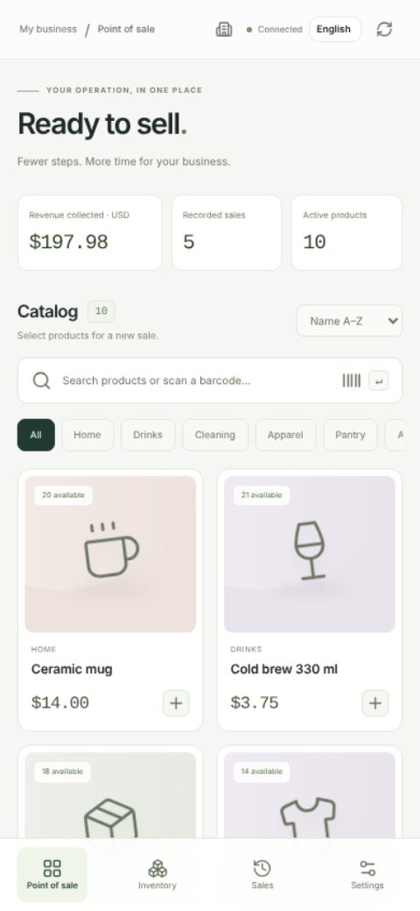</a><br><sub>Point of sale on mobile</sub></td></tr>
<tr><td width="25%" align="center" valign="top"><a href="docs/screenshots/en/21-mobile-checkout.png">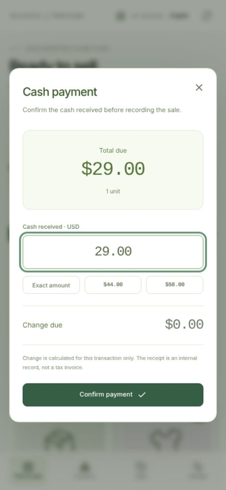</a><br><sub>Checkout on mobile</sub></td><td width="25%" align="center" valign="top"><a href="docs/screenshots/en/22-mobile-inventory.png">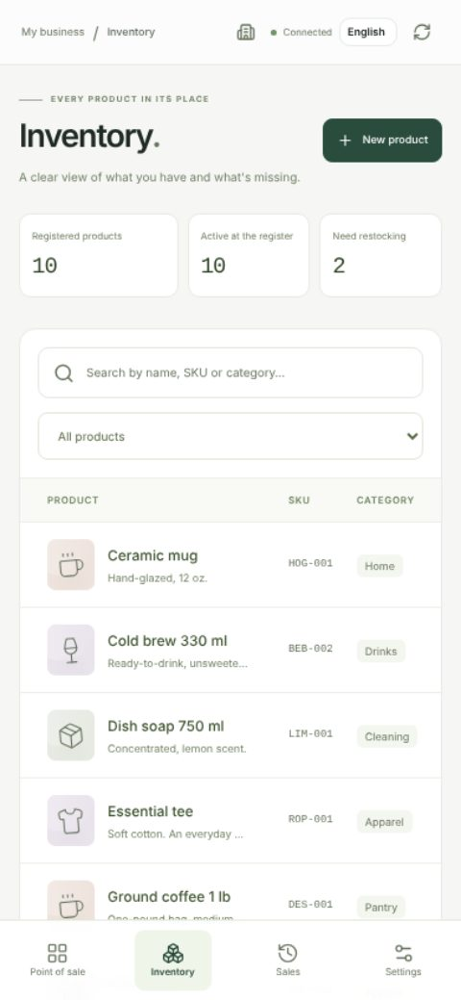</a><br><sub>Inventory on mobile</sub></td><td></td><td></td></tr>
</table>
<!-- screens:end -->

## Inicio rápido

Requiere **Node.js 22+**. CI usa Node.js 24.

```bash
git clone https://github.com/JuanCG13/inzaiq-pos-starter.git
cd inzaiq-pos-starter
npm ci
npm run demo
```

Abrí **[localhost:3001](http://localhost:3001)**. La interfaz sigue el idioma del navegador (inglés o español) y se cambia desde la barra superior; `DEMO_LOCALE=es npm run demo` carga un catálogo de ejemplo en español. La demo crea una base aislada `demo.db` y un `.env.local` ignorado por git con un secreto nuevo; no sobrescribe la configuración existente de un cliente. El acceso demo se limita al desarrollo local y se rechaza en producción. MCP siempre requiere inicio de sesión y consentimiento OAuth reales.

## Configurar una instalación para un cliente

Usá un checkout separado de la demo y configurá la marca, la moneda y los idiomas:

```bash
npm ci
npm run configure -- --name "Mi negocio"                                 # inglés + USD, los valores por defecto
npm run configure -- --default-locale es --locale es-PY --currency PYG   # ejemplo: español y guaraní
cp .env.example .env.local
```

Cada persona ve el idioma que elige en el selector, luego el de su navegador y, por último, el predeterminado de la instalación. La moneda predeterminada es **USD**; cambiala, limitá los idiomas o añadí uno nuevo con la [guía de idiomas y moneda](docs/i18n.md) (en inglés).

Configurá la base de datos, la URL canónica de la aplicación y el secreto de autenticación en `.env.local`, con `DEMO_MODE=false`. Seguí la [guía de ensamblaje](docs/assembly.md) y la [guía de base de datos](docs/database.md), y ejecutá:

```bash
npm run db:migrate
npm run auth:migrate
npm run dev
```

Creá la cuenta del propietario en `/sign-in` y la empresa en `/onboarding`. El cambio de organización verifica la membresía del usuario. Cada variante de talla/color puede representarse con un SKU independiente.

| Punto de ensamblaje | Propósito |
| --- | --- |
| [`src/template.config.ts`](src/template.config.ts) | Marca, idiomas, moneda, formato regional y activación de módulos |
| [`src/i18n/`](src/i18n) | Registro de idiomas, diccionarios tipados y selector de idioma |
| [`template.manifest.json`](template.manifest.json) | Contratos, dependencias y navegación de extensiones |
| [`AGENTS.md`](AGENTS.md) | Reglas para los agentes que modifican una instalación |

Cambiar la moneda configurada no convierte los precios existentes. El manifiesto describe módulos; añadir una entrada no implementa una función. Seguí la [receta de extensión](docs/extending.md) para incorporar capacidades.

## Conectar un agente

Desplegá la aplicación por HTTPS y añadí **`https://tu-dominio/api/mcp`** a un cliente compatible de ChatGPT, Claude u otro host MCP. El propietario inicia sesión, selecciona una empresa y concede los scopes necesarios. La disponibilidad de conexiones depende de la cuenta y de los ajustes del workspace del cliente.

Las herramientas cubren productos, stock, ventas, dashboard, auditoría y ajustes operativos. Las escrituras requieren confirmación explícita y controles del servidor sobre roles y scopes. Revisá o revocá conexiones en `/onboarding/connections`.

La aplicación no necesita una API key de OpenAI o Anthropic. Incluye pruebas locales de OAuth/MCP; la conexión a la cuenta real del cliente debe verificarse durante la instalación. Consultá la [guía MCP](docs/mcp.md).

## Verificación

La [verificación local registrada](docs/verification.md) incluye **152 pruebas automatizadas aprobadas**, **7 recorridos de navegador aprobados**, compilación de producción y comprobación de arranque standalone. Es evidencia local, no un benchmark cloud; el badge de CI enlaza al workflow real de GitHub.

```bash
npm run doctor
DEMO_MODE=false npm run verify
npx playwright install chromium
npm run test:e2e
npm run docs:screenshots   # opcional: regenera todas las capturas desde una instancia aislada real
```

`verify` ejecuta tipos, pruebas y compilación de producción. Las pruebas de navegador usan y modifican una base demo aislada. Las pruebas de dominio ejecutan libSQL real y PostgreSQL WASM; las conexiones a proveedores administrados e integraciones con cuentas externas requieren validación en cada instalación.

## Producción y escala

Se incluyen builds Docker standalone, manifiestos Kubernetes de actualización gradual, readiness con validación de esquema, un template HPA, un comprobador de presupuesto de conexiones y recorridos k6 de lectura. Los avisos y la admisión de ventas cambian en vivo; los cambios de código usan releases inmutables y migraciones compatibles.

| Tarea | Guía |
| --- | --- |
| Publicar, migrar y volver a una versión anterior | [Operación en producción](docs/production.md) |
| Modificar con un agente de forma segura | [Flujo para agentes](docs/agent-workflow.md) |
| Comprender límites de consultas y datos | [Escala](docs/scaling.md) |
| Planificar capacidad e infraestructura | [Preparación enterprise](docs/enterprise.md) · [HPA](deploy/enterprise/README.md) · [Pruebas de carga](tests/load/README.md) |

La conectividad real, restauración de backups, comportamiento de despliegues y capacidad de carga deben validarse en la infraestructura elegida. No se afirma una tasa de tráfico, capacidad de millones de usuarios ni garantía de despliegue sin interrupciones.

**Alcance actual:** ventas en efectivo y tickets internos imprimibles. Los pagos con tarjeta, facturas fiscales, devoluciones, stock fraccionario, múltiples almacenes y sincronización offline requieren módulos adicionales. El ticket no es una factura fiscal.

## Documentación

Los README principales y los historiales de cambios están disponibles en inglés y español. Las guías técnicas usan actualmente ambos idiomas; el [índice de documentación](docs/README.md) identifica el idioma de cada una.

[Idiomas y moneda](docs/i18n.md) · [Pantallas](docs/screenshots/README.md) · [Arquitectura](docs/architecture.md) · [Ensamblaje](docs/assembly.md) · [Base de datos](docs/database.md) · [MCP](docs/mcp.md) · [Telemetría](docs/telemetry.md) · [Ajustes operativos](docs/runtime-settings.md) · [Contratos de extensión](docs/business-models.md)

## Licencia

[MIT](LICENSE). Las dependencias e imágenes de muestra conservan sus respectivas licencias. Reemplazá las imágenes demo por recursos con licencia para la instalación del cliente.
