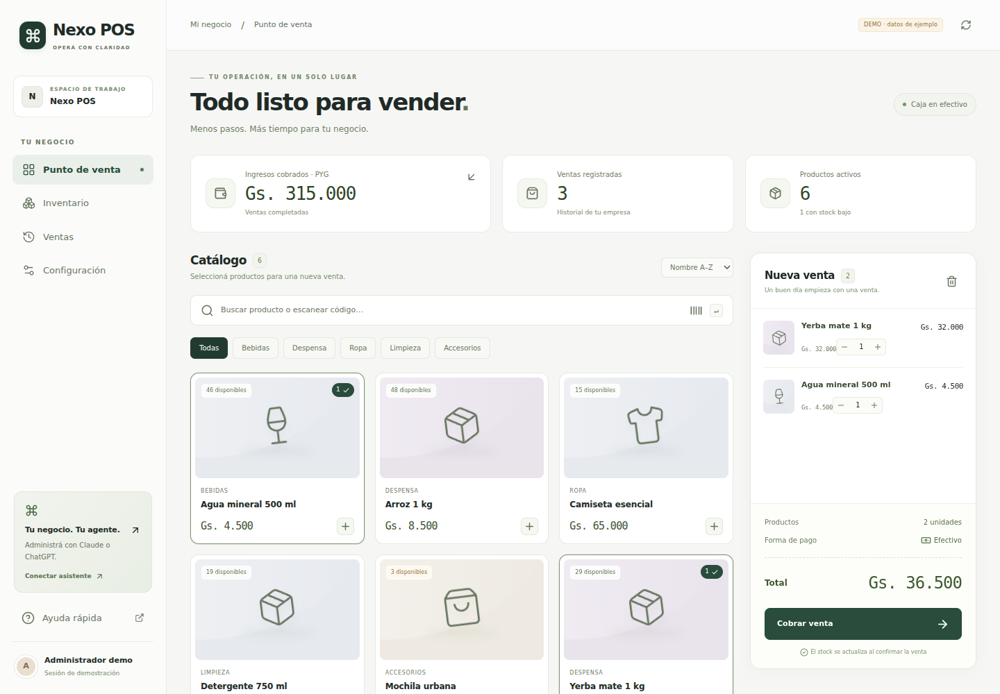
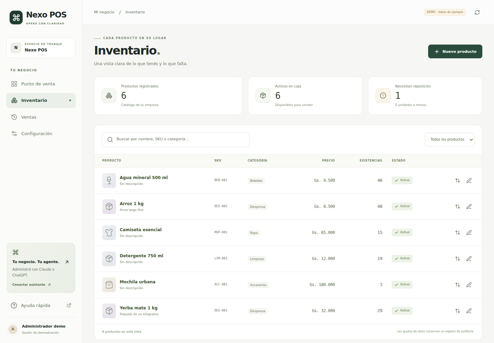
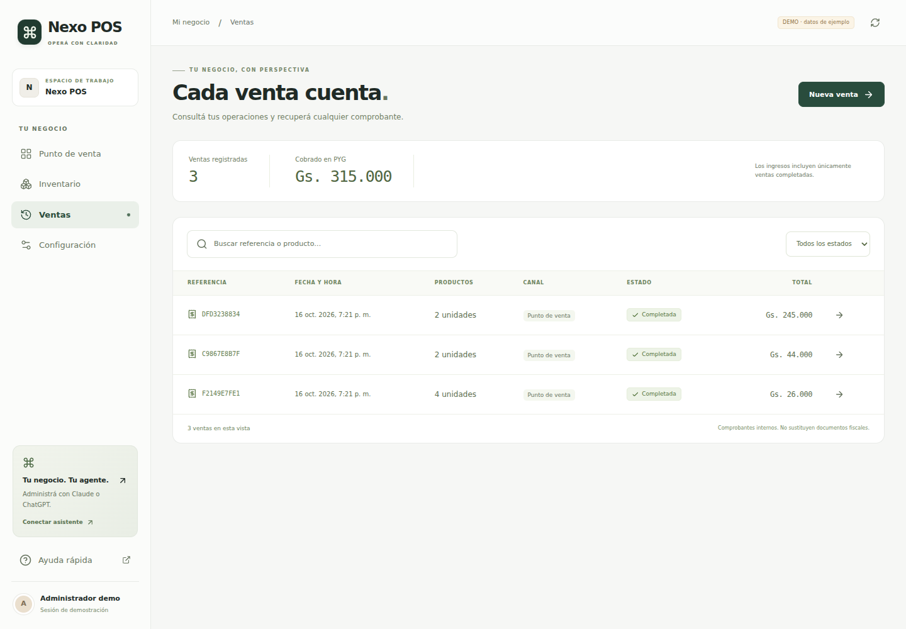
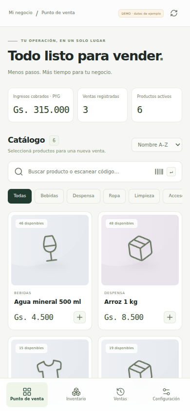

# InzaiQ POS Starter

**Una base preparada para agentes, ventas, inventario y comercios multitenant.**

Creá un punto de venta con marca propia en Next.js y permití que sus administradores lo operen desde la interfaz o desde un agente MCP autorizado. Los servicios modulares, contratos explícitos y reglas de negocio compartidas facilitan extender cada instalación.

[English](README.md) · [Español](README.es.md)

[](https://github.com/JuanCG13/inzaiq-pos-starter/actions/workflows/ci.yml)
[](LICENSE)
[](package.json)
[](package.json)

[Inicio rápido](#inicio-rápido) · [Funciones](#qué-incluye) · [MCP](#conectar-un-agente) · [Documentación](docs/README.md) · [Últimos cambios](CHANGELOG.es.md)



*Las capturas muestran la interfaz de referencia personalizable **Nexo POS**, en español. Adaptá su marca, moneda, formato regional y textos para cada cliente.*

## Qué incluye

| Capacidad | Implementación |
| --- | --- |
| **Caja en efectivo** | Búsqueda de productos, entrada por SKU o lector de códigos con teclado, carrito con control de stock, efectivo recibido, cambio y ticket imprimible |
| **Catálogo e inventario** | Alta y edición de productos, categorías, control de versión y ajustes de stock auditados |
| **Ventas y reportes** | Historial persistente y métricas de la base de datos, separadas por moneda |
| **Múltiples empresas** | Organizaciones de Better Auth con membresía verificada y roles owner, admin, cashier y viewer |
| **Administración por agentes** | SDK oficial MCP, Streamable HTTP, OAuth/PKCE, herramientas con scopes y consentimiento revocable |
| **Ajustes operativos en vivo** | Avisos por empresa y pausa/reanudación de nuevas ventas, con control de versión y auditoría |
| **Diagnóstico** | Logs estructurados, correlación por solicitud, auditoría transaccional y exportación OpenTelemetry opcional |

**Stack:** Next.js App Router · React · TypeScript · Better Auth · Kysely · Radix · Lucide. Los adaptadores admiten **Supabase, Neon, PostgreSQL y Turso**, con SQLite local para desarrollo.

La interfaz, las rutas HTTP y las herramientas MCP usan el mismo servicio de dominio. El acceso a cada empresa surge de membresía verificada; los importes usan unidades menores enteras y precios del servidor. Ventas, stock y auditoría se confirman juntos, con idempotencia persistente para evitar operaciones duplicadas. Los agentes reciben herramientas de negocio concretas, nunca acceso SQL arbitrario.

### Más pantallas

| Inventario | Historial de ventas |
| --- | --- |
|  |  |

<details>
<summary>Punto de venta móvil</summary>



</details>

## Inicio rápido

Requiere **Node.js 22+**. CI usa Node.js 24.

```bash
git clone https://github.com/JuanCG13/inzaiq-pos-starter.git
cd inzaiq-pos-starter
npm ci
npm run demo
```

Abrí **[localhost:3001](http://localhost:3001)**. La demo crea una base aislada `demo.db` y un `.env.local` ignorado por git con un secreto nuevo; no sobrescribe la configuración existente de un cliente. El acceso demo se limita al desarrollo local y se rechaza en producción. MCP siempre requiere inicio de sesión y consentimiento OAuth reales.

## Configurar una instalación para un cliente

Usá un checkout separado de la demo y configurá la marca y el formato monetario:

```bash
npm ci
npm run configure -- --name "Mi negocio" --currency USD --locale en-US
cp .env.example .env.local
```

Configurá la base de datos, la URL canónica de la aplicación y el secreto de autenticación en `.env.local`, con `DEMO_MODE=false`. Seguí la [guía de ensamblaje](docs/assembly.md) y la [guía de base de datos](docs/database.md), y ejecutá:

```bash
npm run db:migrate
npm run auth:migrate
npm run dev
```

Creá la cuenta del propietario en `/sign-in` y la empresa en `/onboarding`. El cambio de organización verifica la membresía del usuario. Cada variante de talla/color puede representarse con un SKU independiente.

| Punto de ensamblaje | Propósito |
| --- | --- |
| [`src/template.config.ts`](src/template.config.ts) | Marca, formato regional, moneda y activación de módulos |
| [`template.manifest.json`](template.manifest.json) | Contratos, dependencias y navegación de extensiones |
| [`AGENTS.md`](AGENTS.md) | Reglas para los agentes que modifican una instalación |

Cambiar la moneda configurada no convierte los precios existentes. El manifiesto describe módulos; añadir una entrada no implementa una función. Seguí la [receta de extensión](docs/extending.md) para incorporar capacidades.

## Conectar un agente

Desplegá la aplicación por HTTPS y añadí **`https://tu-dominio/api/mcp`** a un cliente compatible de ChatGPT, Claude u otro host MCP. El propietario inicia sesión, selecciona una empresa y concede los scopes necesarios. La disponibilidad de conexiones depende de la cuenta y de los ajustes del workspace del cliente.

Las herramientas cubren productos, stock, ventas, dashboard, auditoría y ajustes operativos. Las escrituras requieren confirmación explícita y controles del servidor sobre roles y scopes. Revisá o revocá conexiones en `/onboarding/connections`.

La aplicación no necesita una API key de OpenAI o Anthropic. Incluye pruebas locales de OAuth/MCP; la conexión a la cuenta real del cliente debe verificarse durante la instalación. Consultá la [guía MCP](docs/mcp.md).

## Verificación

La [verificación local registrada](docs/verification.md) incluye **128 pruebas automatizadas aprobadas**, **3 recorridos de navegador aprobados**, compilación de producción y comprobación de arranque standalone. Es evidencia local, no un benchmark cloud; el badge de CI enlaza al workflow real de GitHub.

```bash
npm run doctor
DEMO_MODE=false npm run verify
npx playwright install chromium
npm run test:e2e
```

`verify` ejecuta tipos, pruebas y compilación de producción. Las pruebas de navegador usan y modifican una base demo aislada. Las pruebas de dominio ejecutan libSQL real y PostgreSQL WASM; las conexiones a proveedores administrados e integraciones con cuentas externas requieren validación en cada instalación.

## Producción y escala

Se incluyen builds Docker standalone, manifiestos Kubernetes de actualización gradual, readiness con validación de esquema, un template HPA, un comprobador de presupuesto de conexiones y recorridos k6 de lectura. Los avisos y la admisión de ventas cambian en vivo; los cambios de código usan releases inmutables y migraciones compatibles.

| Tarea | Guía |
| --- | --- |
| Publicar, migrar y volver a una versión anterior | [Operación en producción](docs/production.md) |
| Modificar con un agente de forma segura | [Flujo para agentes](docs/agent-workflow.md) |
| Comprender límites de consultas y datos | [Escala](docs/scaling.md) |
| Planificar capacidad e infraestructura | [Preparación enterprise](docs/enterprise.md) · [HPA](deploy/enterprise/README.md) · [Pruebas de carga](tests/load/README.md) |

La conectividad real, restauración de backups, comportamiento de despliegues y capacidad de carga deben validarse en la infraestructura elegida. No se afirma una tasa de tráfico, capacidad de millones de usuarios ni garantía de despliegue sin interrupciones.

**Alcance actual:** ventas en efectivo y tickets internos imprimibles. Los pagos con tarjeta, facturas fiscales, devoluciones, stock fraccionario, múltiples almacenes y sincronización offline requieren módulos adicionales. El ticket no es una factura fiscal.

## Documentación

Los README principales están disponibles en inglés y español. Las guías técnicas usan actualmente ambos idiomas; el [índice de documentación](docs/README.md) identifica el idioma de cada una.

[Arquitectura](docs/architecture.md) · [Ensamblaje](docs/assembly.md) · [Base de datos](docs/database.md) · [MCP](docs/mcp.md) · [Telemetría](docs/telemetry.md) · [Ajustes operativos](docs/runtime-settings.md) · [Contratos de extensión](docs/business-models.md)

## Licencia

[MIT](LICENSE). Las dependencias e imágenes de muestra conservan sus respectivas licencias. Reemplazá las imágenes demo por recursos con licencia para la instalación del cliente.
